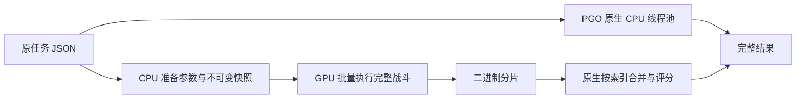

# NVIDIA 完整榜单后端：实现与验证

GPU 后端已能计算完整战斗分片、合并正常榜单行，并与 CPU 同时工作。`0.9.0-preview.1` 将可选 GPU 子进程接入主客户端的榜单调度，领取、续租、任务所有权和提交仍由原 Fleet 路径管理。旧的 `99dec9ad6d01` 离线实测保留在下文；本次部署使用匹配当前引擎 `62a82930d1d3` 的独立 GPU 包，旧模块不会跨版本加载。

Windows / Ryzen 7 9700X / RTX 5080 的固定测试中，CPU 使用 16 条线程，在相同总计算量下加入 GPU 后，两个交替顺序的对照分别提高吞吐 **46.5% 和 44.8%**。输入是公开榜单中的 Fulmin Prime / heavy gunner / semi-auto，每条任务仍为原来的 1,000 次模拟，GPU 每批计算 16 条独立任务。重复输入用于控制基准条件，不产生服务器任务或贡献。

这些数据不能外推为所有武器或线上队列的增幅。Torid 多目标任务在通用 GPU 路线上很慢，适合继续交给 CPU；后续接入实际派单时需要按任务选择设备，并防止 GPU 持有的任务阻塞 CPU 补充工作。

## 实测

固定引擎 `99dec9ad6d01`，上游 `3747fab2571809ae1920bf1f20afaf87e1b6ee0b`，原有六个本地补丁，NVIDIA 驱动 616.92。CPU 基线使用上一轮已验证的 AVX2 PGO DLL。GPU 是 `sm_120` 二进制，本机实测为 RTX 5080。

| 同一计算量的对照 | 仅 CPU | CPU＋GPU | 吞吐比 |
|---|---:|---:|---:|
| 600 条正常任务：440 条 CPU，160 条 GPU | 23.113 s | 16.536 s | 1.398× |
| 632 条正常任务：440 条 CPU，192 条 GPU，先测 CPU 基线 | 25.781 s | 17.602 s | 1.465× |
| 同上，先测 CPU＋GPU | 25.579 s | 17.664 s | 1.448× |

每条任务都是 1,000 次模拟；每个设备都生成完整评分。GPU 等待使用 `CU_CTX_SCHED_BLOCKING_SYNC`，让主机线程阻塞等待，CPU 计算线程能够继续工作。[CUDA 上下文同步文档](https://docs.nvidia.com/cuda/cuda-driver-api/cuda_driver_api/group__CUDA__CTX.html)

| GPU 单独执行的批量 | 情况 | 结果 |
|---|---|---|
| 4,096 次、同一请求的扩展批量 | JSON 分片 | 计算约 1.008 s，CPU 合并约 0.908 s |
| 同上 | 二进制分片＋计量缓存 | 计算约 1.047 s，CPU 合并约 0.015 s |
| 16,384 次、同一请求的扩展批量 | 二进制 | 计算约 1.589 s，CPU 合并约 0.062 s |
| 16 条正常任务，共 16,000 次 | 二进制、与 CPU 同时执行 | 每批连同回读、合并约 1.32 s |
| 32 条正常任务，共 32,000 次 | 二进制 | 每批连同回读、合并约 2.805 s |

扩大批量有效，但 32 条合批没有比 16 条提供更高的单位吞吐。当前这组输入以 16 条合批更合适，不能用“批量越大越快”代替测量。GPU 单独仍慢于整台 16 线程 CPU；实际增益来自两者并行。

机器同时承担桌面活动，全部结果为本机离线基准。原始各轮数据、完整评分、模块哈希和条件在 [`experiments/gpu-board/results.json`](../experiments/gpu-board/results.json)。

## 计算路径



`bridge.rs` 调用原来的 `PreparedBoard::run(index)`。编译链是原 Rust 战斗代码 → WASM → wasm2c C → CUDA → GPU 机器码。保留原战斗循环、随机流和源码计量；没有用近似伤害公式替代模拟。wasm2c 的用途是将 WebAssembly 转换成等价 C。[wasm2c 官方说明](https://github.com/WebAssembly/wabt/blob/main/wasm2c/README.md)

参数准备在 CPU 上完成，然后复制对应 WASM 内存快照。每条 GPU 线程执行一局原始模拟，保留 FP64，关闭 FMA 合并和非正规数截断。多个任务使用独立快照描述符、opaque handle 和 run 索引数组，所以第二条任务仍从自己的 run 0 开始，而不是错误接着第一条的索引计算。

GPU 输出 Postcard 1.1.3 二进制分片，`wire.rs` 使用同版 `Shard` 反序列化。分片经过与原生快速接口相同的 JS 数字规范化检查，再按原顺序调用 `Shard::merge` 和原 `board_score_json`。CPU 合并阶段从约 0.91 s 降到约 0.015 s；模拟和计量数值保持一致。

## 内存与编译

一个准备好的 WASM 快照约 18.69 MiB。直接为每局复制全部内存，会迅速限制批量。新后端按 4 KiB 页复制写入内容，只读页共享，并把每组 32 局的同一 8 字节位置相邻存放。Fulmin 样例每局修改 33 页，即 132 KiB；复杂 Torid 样例最多使用了 141 页。

gas 计数器的位置由 CPU 桥接探针改变、读取和恢复后确认。GPU 将这个逻辑单元放在每局私有状态中，所有相关读写仍保持相同值，包括跨边界和部分字节访问。它省掉重复访存，不减少应返回的 gas。

首次单模块 PTX 组装占用过高。后续改为按函数拆分，再由 nvJitLink 逐个组装、链接；批量入口可单独重编译并复用战斗函数缓存。[nvJitLink 文档](https://docs.nvidia.com/cuda/nvjitlink/index.html)

内存保护落实在 `memory_budget.py`：

- 重型编译和执行进程串行进入，子进程继承同一进程族限额。
- Windows Job 提交上限为 **24 GiB**。
- 每 100 ms 检查进程族私有提交和工作集，达到 **21 GiB** 提前终止实验，给突发分配留余量。
- 小额度的故意超限测试已确认能终止进程。

优化后的完整 CUDA 编译峰值约 3.25 GiB，最终链接约 3.21 GiB。16 条任务并行测试的私有提交峰值约 6.3 GiB；32 条任务合批约 9.89 GiB，工作集约 0.79 GiB。私有提交和工作集分别记录，不能混为同一项。

## 验证范围

- 16,000、32,000 次正常任务合批：逐局完整分片和每条任务评分均一致。
- 两组 632 条任务的 CPU／GPU 对照：每份 CPU 和 GPU 评分均检查，包含 score、metric、counts、gas/work。
- 不同快照混批：Fulmin、Braton、Torid 三种请求，共 3,000 次，分片与评分全部一致。该 Torid 用例缩短为 5 秒以检查混批规则。
- Torid 多目标的完整 180 秒用例：32 次 GPU 分片与原生一致；GPU 约 41.4 秒，表明该路径当前不适合这类任务。
- CUDA 虚拟内存差分：64 条随机程序，每条 1,024 个操作，覆盖非对齐访问、跨页访问、重叠复制、清零、扩容、gas 单元的部分读写和线程隔离。不同线程块大小的完整内存均与 CPU 一致。
- 私有页预算不足会明确失败；故意损坏的二进制分片、错误版本快照会被拒绝。

这些是功能与短程压力验证，未完成新的数天持续部署测试。客户端集成的独立验证记录见部署输出；上面的 44–46% 是旧引擎固定 Fulmin 基准，不能用作新版实网增幅。

## 客户端预览版集成

主程序通过有界 JSON 行协议启动同一可执行文件的 `gpu-worker` 子进程。子进程不读取账号配置、不领取任务、不持有服务器凭据。它核对包内 ABI、引擎、架构与二进制哈希，准备 WASM 快照、运行完整 GPU 战斗，并使用原生 wire 库按 run 顺序合并。每行第一局与桥接 WASM 的完整分片比较，失败不返回可提交的结果。

Fleet 为整行计算分配唯一任务 ID，已经开始 CPU 计算的行不会中途转给 GPU。GPU 持有的行继续参与原有续租和退出逻辑；正常返回走原 `answer` / `answer_row` 和结果日志。取消后迟到的结果会被丢弃。`preview.4` 对 `120` 私有页不足和 `2` 输出容量不足按行回退，其他完整行正常完成，GPU 继续接活；超时或进程异常最多自动重建两次。错误任务 ID、错误分片、版本或评分校验失败仍停用 GPU。回退行从 run 0 回 CPU，不混合部分结果；详见[恢复规则](dispatch-and-gpu-recovery.md)。

当前 `preview.6` 已用[自动学习](gpu-adaptive-dispatch.md)替换手工武器列表。每批最多 16 行、16,000 次，按单局预算和合计内存进一步缩减；CPU 按核心数保留尾部工作，GPU 不会为了凑批创建重复服务器任务。缓冲区按固定槽位复用，WASM 实例每 64 批重建；CPU＋GPU 合计默认 8 GiB，整行批次超时 30 秒，probe 超时 8 秒，启动校验超时 180 秒。系统可用物理内存不足 8 GiB 时不派发新批次。同一登录会话只允许一个 fleet 占用 GPU 0，避免多实例复制大份驱动状态。

配置 `gpu_enabled` 默认 false。设置菜单开启后即时保存，安装对应引擎的 GPU 包才会启用；暂停、退出、引擎切换会结束子进程。无需安装 Python、Rust 或 CUDA SDK；客户端含准备逻辑，GPU 包提供预编译的 cubin、桥接 WASM 和 wire DLL。发布和架构命名见[版本规则](release-versioning.md)。

本机部署验证使用 `62a82930d1d3`、官方 WASM `f6535796d379`、上游提交 `cbf94686e2050145ab650dec115294faed28a812`：

| 检查 | 结果 |
|---|---|
| 客户端 release 单元测试 | 39 通过，7 个原有环境测试忽略，0 失败 |
| 新 GPU 模块完整分片 | 128 局和两条完整评分与同引擎 CPU 一致 |
| 实际 worker 协议连续运行 | 70 批，1,096 条完整评分，16 个不同种子，全部与 CPU 一致 |
| 第 64 批重建后内存 | 最后提交约 6.22 GiB；过程有复用缓冲区波动，未观察到逐批持续增长 |
| 实际 Fleet 的 CPU 回放 | 96 条评分全部一致 |
| 实际 Fleet 的混合回放 | 96 条评分全部一致，其中 20 条由 GPU 完成 |
| 中途结束 GPU 子进程 | 观察到 CPU 回退，96 条评分全部一致，无部分结果提交 |
| 错误引擎、重复任务 ID、第二个 GPU 实例 | 全部拒绝 |
| 官方 WASM 完整行对照 | 1,000 次模拟，1 核和 16 核的 score 位模式、metric、work、counts 全部与原生一致 |

新版构建进程族私有提交峰值约 3.30 GiB；连续 worker 测试进程族约 6.70 GiB；完整 Fleet 与故障测试进程族约 6.79 GiB。GPU 子进程采样提交峰值约 6.42 GiB、工作集峰值约 0.45 GiB。短程测试不能替代数天运行验证。

96 条 CPU 回放耗时 4.466 秒；混合回放 5.904 秒包含约两秒 GPU 冷启动，故障注入回放 6.951 秒也包含初始化和故障恢复。这些用来验证集成完整性，不能表述成新版吞吐提升。旧引擎的充分预热对照仍单独保留。

可复现工具是 `tools/check-gpu-worker.py` 和 `tools/check-gpu-fleet.py`；后者使用明确的离线任务，不领取或提交服务器任务。精简记录在 [`deployment-results.json`](../experiments/gpu-board/deployment-results.json)。本机部署客户端 SHA-256 为 `a1a25a490048a15169b4869961f31eecc7b7f835739df487786f266b63fd79ae`，GPU cubin 为 `15214369b2d382ad1a7fa1cf4a9501dc3ec4d1b5742980dc704593fdfe5f6594`。

## 文件与复现

本机已验证的后端放在 `output/gpu-board-99dec9ad6d01-sm120/`：

| 文件 | 用途 |
|---|---|
| `engine.cubin` | 已编译的 GPU 战斗代码和批量入口 |
| `engine.gpu.json` | 引擎、桥接 WASM、架构、格式和哈希绑定 |
| `bridge.wasm` | 在 CPU 准备同一份战斗参数及快照 |
| `wire.dll` | 二进制分片解码、规范化、按序合并与原始评分 |

执行预编译后端只需要 NVIDIA 驱动，不需要安装 CUDA SDK。准备快照需要 Python 和 Wasmtime；构建时额外使用 WABT 1.0.42、NVRTC 12.9.86、nvJitLink 12.9.86。依赖可安装到独立目录：

```powershell
python -m pip install --target .bench-gpu/python -r experiments/gpu-board/requirements.txt
```

准备一条正常任务并运行 16 条合批基准（`reference.dll` 为同引擎的 PGO 原生库）：

```powershell
python experiments/gpu-board/prepare.py `
  --python-deps .bench-gpu/python `
  --wasm output/gpu-board-99dec9ad6d01-sm120/bridge.wasm `
  --wire-library output/gpu-board-99dec9ad6d01-sm120/wire.dll `
  --native reference.dll --orders experiments/prepared-board/orders.json `
  --row 9 --out .bench-gpu/normal-row

python experiments/gpu-board/packed.py `
  --module output/gpu-board-99dec9ad6d01-sm120/engine.cubin `
  --wire-library output/gpu-board-99dec9ad6d01-sm120/wire.dll `
  --native reference.dll --snapshot .bench-gpu/normal-row --copies 16 `
  --private-kib 192 --cpu-lanes 16 --cpu-rows 440 --repeats 12 `
  --out .bench-gpu/mixed.json
```

`--copies` 仅用于离线基准，不能当成新任务重复提交。多个 `--snapshot` 可合批不同任务。复杂任务需要更大的私有页预算；不足时工具会失败，不会用不完整结果继续评分。

从源码构建使用 `build.py`，输入已经应用 simfleet 本地补丁的上游独立 worktree、同版本原生参考以及本地构建工具路径。脚本依次构建、探测、生成、链接并运行 GPU 对照；`--check` 仅检查配置及 Cargo 清单。当前最终产物来自已实际执行的分阶段命令，一体脚本做过配置检查。脚本和各阶段工具全部保存在 `experiments/gpu-board/`，WABT 许可证也保存在该目录。
